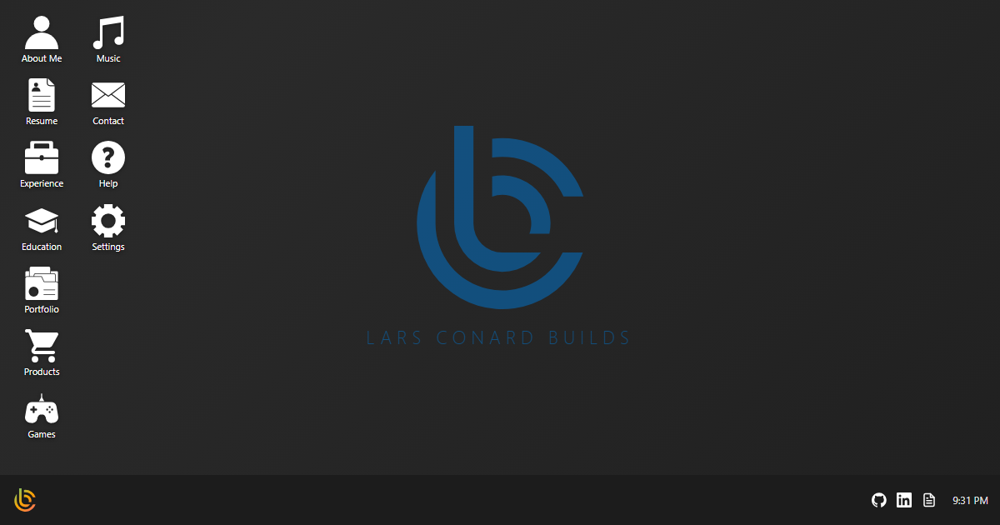

# larsconard.com

Portfolio site for Lars Conard, built as a desktop operating system instead of a scrolling page. Open windows, drag them around, switch themes, and browse work the way you would browse files.

Live at **https://larsconard.com**



## Why it's built this way

Most portfolios are a template with a grid. This one is meant to be the first piece of work you evaluate. Every section of the site (About, Experience, Education, Portfolio, Products, Games, Music, Contact) is an "app" registered in one place and rendered inside a shared window manager, so the site is a small application platform rather than a set of pages.

## What's inside

- **Window manager**: open, focus, drag, resize, minimize, and restore windows, with z-order tracking
- **Start menu and system tray** with quick links
- **Theming** with user-adjustable settings that persist
- **Per-window navigation stack** so an app can push detail views (portfolio item, job, degree) without leaving its window
- **Mobile shell**: a separate layout for phones driven by the same app registry
- **Portfolio browser** with a curated "Top Work" tier, category filters, and case studies on the top projects
- **Embedded games and a music player**, because it's a desktop

## Stack

- React 19, Vite 7
- CSS modules, no component library
- Static deploy to GitHub Pages with a custom domain

## Running it

```bash
npm install
npm run dev      # local dev server
npm run build    # production build to dist/
npm run preview  # serve the production build locally
```

## Layout

```
index.html                 meta tags, Open Graph, noscript fallback
public/                    static assets, resume.pdf, og.png
src/
  App.jsx                  desktop shell
  config/appRegistry.js    every app on the desktop, one entry each
  apps/                    one folder per app (AboutMe, WorkBrowser, Experience, ...)
  components/              window manager, start menu, system tray, taskbar
  context/                 navigation and window state
  data/                    portfolio, experience, education, products, games
  styles/                  theme variables and global CSS
```

## Contact

lars.conard@gmail.com · [LinkedIn](https://www.linkedin.com/in/larsvconard/) · [GitHub](https://github.com/LarsCon)
